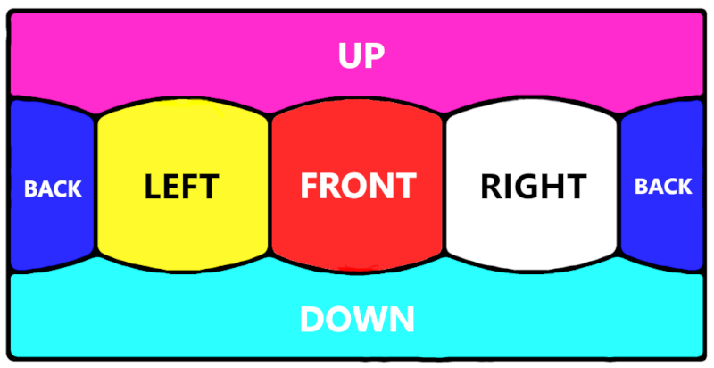
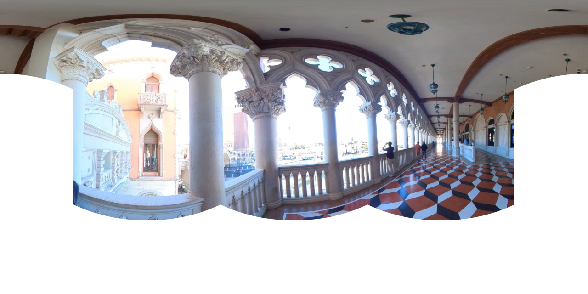
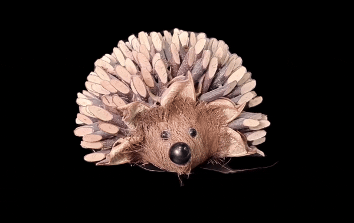
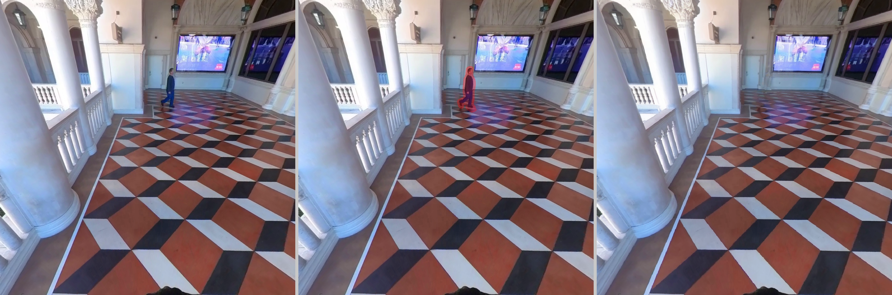

# Understanding the Configuration and Capabilities
This Guidance is built with a variety of open source tools that can be used for various use cases. Because of this, many options are contained in this Guidance. The following is a high-level overview of each option and its applicability.

## Deployment Configuration
Each deployment, CDK and Terraform, have their own deployment configuration which can be found at `deployment/cdk/config.json` and `deployment/terraform/config.json`. Use this configuration to customize your deployment based on your use-case.

### Current Deployment Configuration Supported
- **Account ID:** the AWS account ID to use for the deployment.
- **Region:** the AWS region to use for the deployment.
- **Construct Name Prefix:** the string that will be prepended to deployment resources in order to search more easily and group resources.
- **S3 Trigger Key:** the S3 bucket prefix (folder/directory) to use for the input job configuration. An SNS notification will be setup for this key.
- **Admin Email:** an email address to receive notifications of job status.
- **Maintain S3 Objects On Stack Deletion:** whether to delete or archive the S3 objects created with the resources upon stack deletion
- **Enable CodeBuild Container Build:** whether to enable building the container on the cloud. This will free up your computer from building the container which can take up to an hour to install.

### Current Job Schema Supported

    
Click to expand Job JSON Schema

    {
        "uuid": "010d5342-1876-4012-8868-c548b020b91c",
        "instanceType": "ml.g5.8xlarge",
        "useSpotInstance": "true",
        "logVerbosity": "info",
        "s3": {
            "bucketName": "3dgs-bucket-******",
            "inputPrefix": "media-input",
            "inputKey": "venetian_010d5342-1876-4012-8868-c548b020b91c.mp4",
            "outputPrefix": "workflow-output"
        },
        "imageProcessing": {
            "autoScaleDataset": false,
            "autoScaleDatasetMode": "RESIZE",
            "autoGroupImages": false,
            "autoGroupTargetName": ""
        },
        "videoProcessing": {
            "maxNumImages": "800",
            "videoStartTime": 0,
            "videoStopTime": null,
            "filterBlurryImages": true,
            "adaptiveFrameExtraction": false,
            "adaptiveFrameDensity": "auto"
        },
        "reconstruction": {
            "enable": true,
            "softwareName": "glomap",
            "posePriors": {
                "usePosePriorColmapModelFiles": false,
                "usePosePriorTransformJson": {
                    "enable": false,
                    "sourceCoordinateName": "arkit",
                    "poseIsWorldToCam": true
                }
            },
            "enableEnhancedFeatureExtraction": false,
            "matchingMethod": "sequential",
            "enableFlHeuristic": false,
            "flHeuristicValue": "1.1",
            "enableFlMetric": false,
            "flMetricValue": "24",
            "autoMatcher": false,
            "autoMapper": false
        },
        "training": {
            "enable": true,
            "maxSteps": "30000",
            "model": "splatfacto",
            "preserveSceneScale": false,
            "3dIsp": "bilagrid",
            "enableDepthLoss": false,
            "enhanceDepth": false,
            "calibrateRig": false
        },
        "postProcessing": {
            "cropOutputBounds": true,
            "cropMode": "environment",
            "cleanSplat": false,
            "enableSpz": true,
            "enableSog": true,
            "enableUsdz": false,
            "enableVideoExport": true,
            "generateMesh": true,
            "plyCoords": "rhyu",
            "spzCoords": "rhyu",
            "sogCoords": "rhyu",
            "usdzCoords": "rhyu"
        },
        "sphericalCamera": {
            "enable": true,
            "cubeFacesToRemove": [
                "down",
                "up"
            ]
        },
        "segmentation": {
            "backgroundRemoval": {
                "enable": false,
                "model": "sam2",
                "maskThreshold": "0.6"
            },
            "objectRemoval": {
                "enable": true,
                "action": "erase",
                "objects": "['human']"
            },
            "removeLensFlare": false,
            "removeSky": false
        }
    }

## Container Configuration
- **General**
    - **Workflow input:**
        - Video (.mov or .mp4)
        - Archive (.zip) of images (.png or .jpeg)
        - Archive (.zip) of pose priors and images (transforms.json, colmap model files)
        - Archive (.tar.gz) of previous dataset and checkpoint (for resume training)
    - **Workflow output:**
        - .ply, .sog, .spz, .usdz
        - .mp4 (trajectory rendering), .jpg (render thumbnail)
        - archive of project files (images, point cloud, metadata)
        - evaluation metrics (psnr, ssim, lpips)

- **UUID:** (string), a unique identifier used by backend system to record individual requests in DynamoDB
- **Instance type:** (string), the EC2 compute resource to use for the workflow. Currently, these instance types are tested and supported:
    - ml.g5.4xlarge (recommended for <500 4k images)
    - ml.g5.8xlarge (recommended for <500 4k images)
    - ml.g5.12xlarge (multi-gpu for faster training)
    - ml.g6e.4xlarge (for large datasets (e.g. >500 4k images or 3DGRT))
    - ml.g6e.8xlarge (for large datasets (e.g. >500 4k images or 3DGRT))
- **Use Spot instance:** (boolean), whether to use AWS Batch and spot instances for decrease in processing costs with an increase in queue times
- **Log verbosity:** (string), log levels include info, warning, and error
- **S3:**
    - **Bucket name:** (string), the name of the S3 bucket that was deployed by CDK/Terraform. This is an output from the deployment.
    - **Input prefix:** (string), the S3 prefix (initial directory minus the job prefix) for the input media
    - **Input key:** (string), the S3 key for the input media
    - **Output prefix:** (string), the S3 prefix (initial directory minus the job prefix) for the output files
- **Video processing:**
    - **Max number of images:** (integer), the maximum number of images to use when a video is given as input. If using a `.zip` file with images or pose priors, this parameter will be ignored.
    - **Filter blurry images:** (boolean), whether to remove blurry images from the dataset. For video input, frames are picked with sharp-frame-extractor. For image inputs (a `.zip` or folder of images, a pose-prior `.zip`, or a COLMAP model `.zip`), each image's sharpness (variance of the Laplacian, ignoring masked pixels) is compared with its neighbours in name order within the same folder, and images below half of their neighbours' median are removed, at most 15% per folder. Removed images are also taken out of the COLMAP model (images, point tracks, rig frames), any COLMAP database (`*.db`: images, keypoints, descriptors, matches, two-view geometries, frames, pose priors), `transforms.json`, `masks/` and the depth folders. The removed files and the original models and databases are kept in `blur_filter/` in the dataset, with the per-image scores in `blur_filter/report.json`. Not applied when resuming from a `model.tar.gz`.
    - **Video start time:** (integer), the time in seconds to start extracting frames from the video.
    - **Video stop time:** (integer), the time in seconds to stop extracting frames from the video.
    - **Adaptive frame extraction:** (boolean, default `false`), video input only. Picks frames by camera motion with [adaptive-frame-extractor](https://github.com/morishuz/adaptive-frame-extractor) (MIT) instead of at regular intervals, so fast-moving sections get more frames and slow or stationary sections get fewer. It can be combined with **Filter blurry images**:

        | Adaptive frame extraction | Filter blurry images | Frames used |
        |---|---|---|
        | false | false | Regular intervals |
        | false | true | Sharpest frame in each regular block (sharp-frame-extractor) |
        | true | false | Motion-adaptive keyframes |
        | true | true | Motion-adaptive keyframes, each replaced by the sharpest frame in its block (sharp-frame-extractor's Tenengrad score). A keyframe's block reaches halfway to its neighbouring keyframes, capped at ±0.25 s. |

        **Max number of images** is a cap: if more keyframes are found, they are thinned evenly. If the tool fails or finds fewer than 2 keyframes, regularly spaced frames are used instead. Video start/stop time are honoured. A `report.json` with the chosen source frame indices is written to `adaptive_frames/` in the job's dataset folder.
    - **Adaptive frame density:** (string, default `auto`), one of `auto`, `low`, `medium`, `high`. `auto` adjusts the motion threshold (up to 3 passes) to land near **Max number of images**. `low`/`medium`/`high` use the tool's fixed profiles, which can give far fewer frames than requested on slow footage (for example 15 or 31 frames from a 100-second vehicle video).
- **Image processing:**
    - **Autoscale dataset:** (boolean), when enabled, automatically resizes or drops images so the dataset fits within the GPU's VRAM budget. Images are capped at 4K resolution (3840px long edge) regardless of VRAM. Two modes are available:
        - **RESIZE** (default): downscales all images to a resolution that fits in VRAM while maintaining aspect ratio (minimum 1080p)
        - **DROPOUT**: uniformly drops images to reduce count while preserving the original resolution
    - **Autogroup images:** (boolean), when enabled, filters images by a target filename prefix (e.g. "dji") to select only matching images from a mixed dataset. Useful when a folder contains images from multiple cameras or capture sessions.
        - **Autogroup target name:** (string), the filename prefix to filter by (e.g. "dji" keeps only files starting with "DJI")
- **Reconstruction (SfM):**
    - **Enable:** (boolean), whether to enable SfM or not. Future plans will enable input of SfM output
    - **Software name:** (string), colmap, glomap, or hloc. Software to use for the triangulation of the mapper
    - **Auto mapper:** (boolean), when enabled, overrides the **Software name** at runtime based on the actual image count after pre-processing:
        - < 600 images → **glomap** (global mapper — fast for small sets)
        - 600–5000 images → **colmap** (incremental mapper — robust for medium sets)
        - \> 5000 images → **hloc** (hierarchical mapper — scales to large sets)
    - **Enable enhanced feature extraction:** (boolean), whether to enable enhanced feature extraction which uses `estimate_affine_shape` to enhance the feature matching
    - **Matching method:**
        - sequential (best for videos or images that share overlapping features)
        - spatial (best to use for pose priors or GPS to take spatial orientation into account)
            - **GPS pose priors:** when reconstruction is enabled with spatial matching, no pose-prior options are set, and at least half of the uploaded images carry GPS (EXIF `GPSLatitude`/`GPSLongitude`/`GPSAltitude`, or a `priors.csv` in the zip with `image,lat,lon,alt_m` columns), the pipeline uses COLMAP `pose_prior_mapper` instead of `mapper`. The camera positions are then held close to the GPS positions, so the model is in metres in a local east-north-up frame. GPS is read right after the upload is extracted, because resizing and rotation drop EXIF, and is written into the COLMAP database after feature extraction (`gps_priors.json` in the dataset). The GPS standard deviation defaults to 5 m horizontal and 10 m vertical; a session `manifest.json` in the zip can set it with `gps.suggested_prior_std_m` `{x, y, z}` and can supply exact shared intrinsics with `camera` `{model: PINHOLE, width, height, fx, fy, cx, cy}` (scaled to the processed image size and kept fixed). GLOMAP and hierarchical mappers ignore GPS, so these jobs use COLMAP, and Auto mapper/Auto matcher are turned off. If fewer than half of the images end up with a prior in the database, the standard mapper runs.
            - **Camera rigs:** an image zip with a COLMAP [`rig_config.json`](https://colmap.github.io/rigs.html){:target="_blank"} is reconstructed as a rig. Use COLMAP's rig layout, `images/<camera>/<frame>.jpg`, with the same frame file name in every camera folder (masks as `masks/<camera>/<frame>.jpg.png`), and set each camera's `image_prefix` to `<camera>/`. The camera folders are kept, features are extracted with one camera per folder, and `colmap rig_configurator` groups the images of each frame before matching. The mapper then solves one pose per frame and keeps the cameras' relative poses from the config fixed (`--Mapper.ba_refine_sensor_from_rig 0`), so bundle adjustment moves the cameras of a frame together. Works with GPS pose priors. Pose-prior options must be off.
            - **Masks in an image zip:** a `masks/` folder in a plain image zip (`masks/<image name>.png` or `masks/<image stem>.png`, white = keep) is used for COLMAP feature extraction and for training. Images without a mask keep all pixels.
        - vocab (best for large datasets that are not sequentially bound)
        - exhaustive (only use this method if dataset struggles to converge with other methods)
    - **Auto matcher:** (boolean), when enabled, overrides the **Matching method** at runtime by analyzing image overlap using ORB feature matching on sampled pairs. The analysis uses multi-stride sampling (stride 1, 2, 3) with median overlap and a "sequential signal" metric (fraction of consecutive pairs with meaningful overlap) to tolerate scattered non-overlapping frames. Decision logic (evaluated in order, first match wins):
            1. GPS EXIF coordinates detected or pose priors enabled → **spatial** — leverages known camera positions for efficient neighbor lookup
            2. ≥70% of consecutive pairs overlap AND median overlap ≥ 0.20 → **sequential** — images are in capture order with strong frame-to-frame continuity (e.g. video frames, walk-around captures)
            3. \> 1000 images with median overlap ≥ 0.10 → **vocab** — exhaustive matching on large datasets is O(n²) which becomes prohibitively slow (e.g. 4000 images = ~16M pairs). Vocab tree matching uses a visual vocabulary to find likely matches in roughly O(n·log n), dramatically reducing matching time while still finding cross-scene matches that sequential would miss. This is the typical result for large drone datasets where images aren't strictly sequential after pre-processing (autogroup, autoscale)
            4. Median overlap < 0.10 → **exhaustive** — low overlap means the scene has few shared features between neighbors, so brute-force comparison of all pairs gives the best chance of finding matches
            5. \> 1000 images (any overlap) → **vocab** — catches large datasets that passed the sequential signal check but didn't meet the median threshold
            6. Fallback → **exhaustive** — most reliable method for small-to-medium unordered datasets where the O(n²) cost is acceptable
    - **Enable focal length heuristic:** (boolean), whether to enable focal length estimate to help normalize the scene scale if focal length is unknown. This uses the formula `focal_length = fl_heur_val*max(x_res, y_res)`
    - **Focal length heuristic value:** (string), coefficient used in focal length heuristic (default: 1.2).
    - **Enable focal length metric:** (boolean), whether to use a known metric focal length in pixels directly instead of estimating it. Takes priority over the heuristic if both are enabled.
    - **Focal length metric value:** (string), the known focal length in pixels to use when `enableFlMetric` is true (default: 24). in order to speed up reconstruction, camera poses associated with the images can be used as input. In particular, this feature accepts a `.zip` archive folder that has the same schema as [NerfCapture](https://github.com/jc211/NeRFCapture/tree/main){:target="_blank"} or can be a `.zip` archive folder that contains images and sparse directories with [Colmap model text files](https://colmap.github.io/faq.html#reconstruct-sparse-dense-model-from-known-camera-poses){:target="_blank"}.

        > *Note: The primary use case for `enableDepthLoss` is when providing a LiDAR-derived point cloud via `usePosePriorColmapModelFiles`. The LiDAR point cloud is projected as sparse depth supervision during training, anchoring Gaussians to accurate metric geometry. It also works with standard colmap reconstructions as a weaker depth signal. Depth image files are not required.*

        > ***Note:** All image files must be sequentially named and padded (e.g. 001.png, 002.png, etc.)*
    - **Pose Priors**
        - **Calibrate camera rig (`calibrateRig`):** (boolean, default false), for multi-camera mobile exports that include COLMAP 4 rig files (`rigs.bin` + `frames.bin`), e.g. an iPhone with an Insta360 camera mounted to it. Before training, the pipeline runs a quick SfM on the session's images, measures how the 360 camera is actually mounted relative to the iPhone, and rewrites `rigs.bin` and the 360 camera poses in `images.bin`. The iPhone poses are not changed. Only sensors (cube faces or fisheye lenses) whose masks leave at least 30% of the image visible are used for the fit. If too few 360 images register (fewer than 10) or the fit is not reliable, the original poses are kept and the reason is logged. The result is written to `calibrate_rig/report.json` in the dataset, with the original files in `calibrate_rig/original/`. Uploads without rig files are not affected. This is different from `refinePoses`, which adjusts each image's pose during training.
        - **Bundle adjust COLMAP model (`bundleAdjustColmapModel`):** (boolean, default false), for an uploaded COLMAP model `.zip` that is trained as-is (`reconstruction.enable` false), e.g. ARKit poses with LiDAR points and depth. Before training, the pipeline refines the camera poses with bundle adjustment. Pose-only exports have no 2D-3D tracks, so it first extracts features with the model's own intrinsics, matches only images that are near each other according to the known poses, and triangulates points with the poses held fixed. The intrinsics, rig and depth files are kept, and the refined poses are aligned back to the input camera centres so the metric scale is preserved. If the upload has ARKit LiDAR depth maps (`depths/*.bin`), `points3D` is rebuilt from them with the refined poses (the input cloud was fused with the old poses); the depth-map rotation is detected by comparing against the input cloud, and the input points are kept if the depth maps do not reproduce them. Without depth maps, `points3D` is left unchanged. If the reprojection error does not improve or the poses move implausibly far, the original model is kept. The report is written to `bundle_adjust/report.json` in the dataset, with the original model in `bundle_adjust/original/`. It runs after `calibrateRig` and can be combined with `refinePoses`, which corrects the small remaining error during training. With reconstruction enabled and pose priors (`usePosePriorColmapModelFiles` or `usePosePriorTransformJson`), this setting instead turns on COLMAP `bundle_adjuster` after triangulation; without it the known poses are kept fixed.
        - **Use pose prior Colmap model files:** see [Colmap model text files](https://colmap.github.io/faq.html#reconstruct-sparse-dense-model-from-known-camera-poses){:target="_blank"}
            - With reconstruction enabled, known poses follow the COLMAP FAQ: features are extracted and matched, then `point_triangulator` builds the points with the poses and intrinsics held fixed. Poses and intrinsics are only refined (`point_triangulator --refine_intrinsics 1` followed by `bundle_adjuster`) when `bundleAdjustColmapModel` is true.
            - The file schema for providing the already created Colmap model files looks like this
                

                
<strong>Archive structure (.zip)</strong>

                <pre style="background-color: #F6F6F6;">
                <code>
                archive.zip
                ├── images/
                    └── *.{png,jpg,jpeg}
                └── sparse/
                    ├── 0/
                        └── cameras.txt (camera intrinsics)
                        └── images.txt (camera extrinsics/poses)
                        └── points3D.txt (empty)
                </code>
                </pre>
                

        - **Use pose prior transform JSON:** see [NerfCapture](https://github.com/jc211/NeRFCapture/tree/main){:target="_blank"}
            > *Ensure the `.zip` contains both the `transforms.json` file and an `/images` directory with sequentially named RGB images.*
            - **Enable:** (boolean), whether to enable using `transforms.json` file for pose priors.
            - **Source coordinate name:** ("arkit" or "arcore" or "opengl" or "opencv" or "ros"), the source coordinates used with pose priors
            - **Pose is world-to-camera:** (boolean), whether the source coordinates for pose priors are in world-to-camera (True) or camera-to-world (False)
            - The schema for `transforms.json` to input looks like this in case you would perform an alternate method to extract the image and poses.
                > ***Note:** Depth images do not need to be present in the `.zip` file, but the "depth_path" still needs to be filled so the extension is known. For example if image is `images/3.png`, then `depth_path=images/3.depth.png` and `file_path=images/3`. `timestamp` and `depth_images` are not currently used in the pipeline.*
                

                
<strong>Sample <code>transforms.json</code> contents</strong>

                <pre style="background-color: #F6F6F6;">
                <code>
                {
                    "frames": [
                        {
                            "fl_y": 1363.47,
                            "w": 1920,
                            "fl_x": 1363.47,
                            "cy": 728.95135,
                            "timestamp": 309075.09929275,
                            "depth_path": "images/3.depth.png",
                            "transform_matrix": [
                                [
                                    -0.98750305,
                                    0.08610178,
                                    -0.13199921,
                                    0.9487833
                                ],
                                [
                                    0.024557188,
                                    0.91140217,
                                    0.41078326,
                                    -0.5495963
                                ],
                                [
                                    0.1556736,
                                    0.40240824,
                                    -0.9021269,
                                    -0.4476293
                                ],
                                [
                                    0,
                                    0,
                                    0,
                                    1
                                ]
                            ],
                            "file_path": "images/3",
                            "cx": 956.5136,
                            "h": 1440
                        },
                        ...
                    ]
                }
                </code>
                </pre>
                

            - Parameter definitions
                

                
<strong>Parameter defintions</strong>

                <pre style="background-color: #F6F6F6;">
                <code>
                "cx": camera sensor center on x-axis in pixels
                "cy": camera sensor center on y-axis in pixels
                "fl_x":  focal length on x-axis in pixels
                "fl_y": focal length on y-axis in pixels
                "w": camera resolution width in pixels
                "h": camera resolution height in pixels
                "file_path": this will look like this: "images/13" if image filename is images/13.png
                "depth_path": this will look like this: "images/13.depth.png" if image filename is images/13.depth.png (even if you dont have depth images, fill this in with correct extension)
                "transform_matrix": 4x4 pose matrix
                "timestamp": seconds (can be absolute or use epoch)
                </code>
                </pre>
                

            - Archive structure (.zip)
                

                
<strong>Archive structure (.zip)</strong>

                <pre style="background-color: #F6F6F6;">
                <code>
                archive.zip
                ├── transforms.json
                └── images/
                    └── *.{png,jpg,jpeg}  # Image files, depth images need "depth" in file name
                </code>
                </pre>
                

- **Training:**
    - **Enable:** (boolean), whether to enable 3DGS training or not. Future plans will enable user to only perform SfM
    - **Maximum steps:** (integer), The maximum training steps to use while training the splat
    - **Number of Gaussians (`numGaussians`):** (integer, default 1000000), MCMC models only (splatfacto-mcmc, gsplat-depth-mcmc, multi-GPU gsplat). MCMC starts with one Gaussian per SfM point and only adds Gaussians up to this cap, so a cap at or below the point count leaves it no room to grow. At training time the cap is therefore raised to 2.5x the SfM point count, but not beyond an estimate of what fits in GPU memory (about 1.2 GB plus 0.8 GB per training-image megapixel per million Gaussians, plus the GPU image cache, within 85% of GPU memory minus 2.5 GB). The value you set is always kept as the minimum. The cap used is logged as `MCMC Gaussian cap …`.
    - **Splat model:** (string), splatfacto, splatfacto-mcmc, splatfacto-big, splatfacto-w-light, 3dgrt, 3dgut, nerfacto, dn-splatter, ags-mesh, gsplat-depth, faster-gs. The 3DGS model to use for training
        - Pointers:
            - **splatfacto:** a great, generalized model that is perfect to start with if you are unsure what model to choose
            - **splatfacto-big:** high quality model that should be used to output feature-rich scenes and objects. This will yield a larger .ply file.
            - **splatfacto-w-light:** if wanting to achieve superior quality, while still pruning unwanted gaussians, use this one. This model will take the longest time, but the output file size will be much less, while still upholding quality.
            - **splatfacto-mcmc:** the current SotA that balances small training time with high quality output
            - **nerfacto:** used for testing and comparisons between NeRF and GS. The output will be a NeRF. Beware, this model will need more images than GS in order to maintain higher quality.
            - **3dgut:** used for enabling Distorted Cameras and Secondary Rays in Gaussian Splatting. Great for fisheye camera input.
            - **3dgrt:** used for 3D Gaussian Ray Tracing and Fast Tracing of Particle Scenes. Great for highly detailed scenes at the cost of processing power and time
            - **faster-gs:** [Faster-GS](https://github.com/nerficg-project/faster-gaussian-splatting) (CVPR 2026) running on the NeRFICG framework. The fast option alongside splatfacto/gsplat. It runs with Speedy-Splat pruning, which trains about 2× faster than Faster-GS defaults with far fewer Gaussians (smaller PLYs and faster rendering), at some cost to fine detail compared with splatfacto. It trains on a single GPU (GPU 0 on multi-GPU instances) and needs pinhole cameras: SfM runs with `PINHOLE`, and an existing non-pinhole COLMAP model is undistorted automatically before training. `3dIsp` `ppisp` (or `bilagrid`, mapped to PPISP) enables per-image photometric compensation. `enableAbsGrad` enables AbsGS densification. Every 8th image is held out for metrics. The PLY is exported in the COLMAP world frame. Not supported: mesh export, resume training from a checkpoint (a `model.tar.gz` input retrains from the archived dataset), and `preserveSceneScale` (the output is always in COLMAP scale).
            - **dn-splatter:** depth and normal supervised Gaussian Splatting via the dn-splatter library. Improves geometric accuracy by incorporating monocular depth and normal priors during training. Best suited for scenes where surface geometry matters. Requires a Colmap reconstruction.

                **Sensor depth (optional):** If your dataset includes LiDAR or RGB-D sensor depth images (e.g. from an iPhone, RealSense, or similar), you can include them in the zip to enable sensor-depth-guided alignment of the scale-aligned mono depths. The pipeline automatically detects and uses them.

                | Requirement | Detail |
                |---|---|
                | **Folder name** | `depth/` or `depth_images/` inside the zip |
                | **File naming** | Must match image stems after flattening. Flat images: `0.png` → depth `0.png`. Subdir images: `face_00/pano_008.png` → depth `face_00/pano_008.png` **or** `face_00_pano_008.png` (both work — subdirs are auto-flattened to `face_00_pano_008.png` during preprocessing) |
                | **File format** | **uint16 PNG, values in millimeters** — e.g. a pixel at 2.5 m must have value `2500`. Standard ARKit `.depth.png` files are **not** compatible as they are uint8 confidence maps, not metric depth. |
                | **Resolution** | Any — the pipeline resizes to match the image |

                > *Note: If sensor depth is present but not in the correct uint16 mm format, training will silently fall back to scale-aligned monocular depth (ZoeDepth + SfM alignment), which is the default and produces good results for most datasets.*

            - **ags-mesh:** advanced Gaussian Splatting with mesh extraction, built on dn-splatter. Produces a mesh output alongside the Gaussian splat. Best for rigid objects where a clean surface mesh is desired in addition to the splat. Requires a Colmap reconstruction. Accepts the same optional sensor depth format as dn-splatter above.
            - **gsplat-depth:** Gaussian Splatting with sparse depth loss supervision using gsplat's `simple_trainer`. Anchors Gaussians to the Colmap or LiDAR-derived point cloud for improved metric accuracy. Useful when accurate geometry is required and a pose prior with point cloud data is available. Video export and nerfstudio metrics are not available with this model.
    - **Preserve scene scale:** (boolean), whether to preserve the reconstruction scale during gaussian splat training
    - **3D image signal processing:** (string), technique to use for scene signal processing. Current options are bilagrid (bilateral grid), ppisp (physically plausible image signal processing). For `dn-splatter`, `dn-splatter-big`, and `ags-mesh`, `bilagrid` learns a per-image color correction during training (useful for iPhone auto-exposure/white-balance changes); `ppisp` is not available for these models and falls back to `bilagrid`.
    - **Enable depth loss:** (boolean), whether to enable sparse depth supervision during training. The primary use case is when a LiDAR-derived point cloud is provided as pose prior input (via `usePosePriorColmapModelFiles`), giving the trainer accurate metric depth to anchor the Gaussians. It also works with standard colmap point cloud projections as a weaker depth signal. When enabled, overrides the model choice and uses gsplat's `simple_trainer` with depth loss. Requires a colmap reconstruction. Improves geometric accuracy especially for scenes with strong depth cues. Video export and nerfstudio metrics are not available when this is enabled.
    - **Enhance depth:** (boolean), whether to enhance sparse LiDAR depth maps using [PromptDA](https://github.com/DepthAnything/PromptDA) before training. PromptDA uses a vision transformer (DINOv2 ViT-L) to densify sparse metric depth by fusing the RGB image with the sparse depth as a prompt, producing dense metric-aligned depth maps. This is particularly useful when using LiDAR pose priors (`usePosePriorColmapModelFiles`) where the raw depth maps are low-resolution (e.g. 256×192 from ARKit). The enhanced depth maps are written back to the `depths/` directory before training begins.
        - Valid values: `"true"`, `"false"`
        - Default: `"false"`
        - Requires: depth maps present in `depths/` or `depth_images/` directory
        - Note: Downloads the `depth-anything/promptda_vitl` model weights (~1.3GB) from HuggingFace on first use if not cached in `models.tar.gz`

- **Post Processing:**
    - **Crop output bounds:** (boolean), whether to crop gaussians that are outliers.
    - **Crop mode:** (string), mode to use for cropping the gaussian scene. Options include environment and rigid_object.
    - **Clean splat:** (boolean), whether to remove floating/outlier Gaussians from the splat using `splat-transform --filter-floaters`. This removes isolated clusters of Gaussians that are disconnected from the main scene.
        - Valid values: `"true"`, `"false"`
        - Default: `"false"`
    - **Enable spz output:** (boolean), whether to output a compressed .spz file.
    - **Enable sog output:** (boolean), whether to output a compressed .sog file.
    - **Enable usdz output:** (boolean), whether to output a compressed .usdz file.
    - **Enable video export:** (boolean), whether to render and export a trajectory flythrough video (.mp4) and thumbnail (.png) of the trained splat.
    - **Generate collision:** (boolean), whether to generate a sparse voxel octree (`.voxel.json` / `.voxel.bin`) and collision mesh (`.collision.glb`) from the splat for runtime collision detection in PlayCanvas / supersplat-viewer.
        - Valid values: `"true"`, `"false"`
        - Default: `"false"`
    - **Collision scene type:** (string), controls the voxel fill and carve strategy used when generating collision data.
        - `"indoor"` — for enclosed rooms and buildings: seals the exterior void then carves navigable interior space (`--voxel-external-fill --voxel-carve`)
        - `"outdoor"` — for terrain and open scenes: fills the ground beneath surfaces then carves navigable space (`--voxel-floor-fill --voxel-carve`)
        - `"object"` — for isolated objects with no walkable floor: bare voxelization only, no fill or carve
        - Default: `"outdoor"`
    - **Collision seed position:** (string), `"x,y,z"` world-space point used as the seed for `--filter-cluster` and voxel fill/carve passes. Should be a known point inside the scene (e.g. a walkable floor position). If the default `"0,0,0"` is outside or inside solid geometry, adjust to a point clearly inside the open space.
        - Default: `"0,0,0"`
    - **Generate LOD:** (boolean), whether to generate a streamed multi-LOD SOG bundle (`lod-meta.json`) from the splat. Produces 4 decimation levels (100%, 50%, 25%, 12.5%) that PlayCanvas viewers can stream progressively based on camera distance.
        - Valid values: `"true"`, `"false"`
        - Default: `"false"`
    - **Generate mesh:** (boolean), whether to extract a surface mesh from the trained model. The extractor depends on the model: `dn-splatter`, `dn-splatter-big`, and `ags-mesh` use their native TSDF extractor; other Gaussian splat models (splatfacto variants, gsplat) use TSDF fusion with surface regularization, xatlas UV unwrapping, and camera-projection texture baking. Both write `mesh.glb`, uploaded to S3 as `<name>.mesh.glb`. Not supported for `nerfacto`, `3dgrt`, `3dgut`, or `faster-gs`. A failed mesh extraction does not fail the job. The former `extractMeshGs` setting is accepted as an alias for this setting.
        - Valid values: `"true"`, `"false"`
        - Default: `"true"`
    - **Ply Coordinates:** (string), the coordinate system to transform the .ply to. Options include rhyu (right-hand, y-up, playcanvas), lhyu (left-hand, y-up, babylon.js), rhzu (right-hand, z-up, blender), and lhzu (left-hand, z-up, unreal)
    - **Spz Coordinates:** (string), the coordinate system to transform the .spz to. Options include rhyu (right-hand, y-up, playcanvas), lhyu (left-hand, y-up, babylon.js), rhzu (right-hand, z-up, blender), and lhzu (left-hand, z-up, unreal)
    - **Sog Coordinates:** (string), the coordinate system to transform the .sog to. Options include rhyu (right-hand, y-up, playcanvas), lhyu (left-hand, y-up, babylon.js), rhzu (right-hand, z-up, blender), and lhzu (left-hand, z-up, unreal)
    - **Usdz Coordinates:** (string), the coordinate system to transform the .usdz to. Options include rhyu (right-hand, y-up, playcanvas), lhyu (left-hand, y-up, babylon.js), rhzu (right-hand, z-up, blender), and lhzu (left-hand, z-up, unreal)

- **Spherical camera:**
    - **Enable:** (boolean), whether to enable 360 camera support or not
    - **Cube faces to remove:** "['back', 'down', 'front', 'left', 'right', 'up']", a list of cube faces to remove from the spherical image. This is great for cropping out people or objects from the 360 image. 

    > *Note: The above configurations were tested with an Insta360 ONE X2, exporting frame(s) in equirectangular format, 9:16 ratio, 5.7k resolution, and 30 frames per second. The captures were taken with the camera display aimed toward the person capturing the frame(s).*

    

     
     
    <i>Figure 1: Equirectangular cube map views from a spherical camera</i>
    

    

     
    

    

     
     
    <i>Figure 2: Equirectangular cube map views from a spherical cameraExample: Enable Spherical Camera = true, Cube Faces to Remove = "['back', 'down']"</i>
    

     
    

- **Segmentation:**
    - **Background removal:**
        - **Enable:** (boolean), whether to remove the background when input an object (not scene) or not
        - **Background removal model:** "u2net" or "sam2" the background removal model to use
        > *Note: The sam2 model can only be used on video at this time*
        - **SAM2 mask threshold:** (string), threshold to use for mask. If object doesn't have large contrast from the background, use lower number like 0.38.

    

     
     
    <i>Figure 3: Background removal using SAM2</i>
     

- **Object removal:**
    - **Enable:** (boolean), whether to remove objects from images
    - **Action:** (string), whether to erase or remove the objects.
    - **Objects:** (string list), the list of objects to remove. Currently only human is supported.

    

     
     
    <i>Figure 4: Erasing humans from the dataset</i>
    

- **Lens flare and sky masking:** both write training masks to `masks/` (white = keep) instead of editing the images. COLMAP extracts no features in masked pixels and the splat trainers ignore them, so the other views fill the area in. The masks are combined with any uploaded masks. They run on the final images (after video extraction, resizing, rotation and object removal), sky first, then lens flare, so the flare detector only looks at what is left of the scene. Works for videos, image zips and COLMAP model zips; not available with `sphericalCamera.enable` true. Overlay previews are written to `mask_previews/` in the dataset. If a step fails, the job continues without it. The images themselves are not changed: the sky and flare are excluded from training, so they are left empty in the splat. Masks are used in training by splatfacto, gsplat-depth/gsplat-depth-mcmc, multi-GPU gsplat, 3dgut, dn-splatter (via `transforms.json`) and faster-gs.
    - **Remove lens flare (`removeLensFlare`):** (boolean, default false), masks sun glare, streaks and the veiling flare around bright light sources. Classical image processing (no model download). Brightness alone is not used, because sunlit walls and pavement are as bright as glare. Glare is a haze added on top of the scene, so inside it even the darkest parts of the scene (shadows, gaps in foliage) are lifted, and the lift fades smoothly with distance from the sun. The detector therefore measures the scene's local dark level: a candidate light source (a clipped blob, with fragments split by branches merged) is accepted only when its edge is soft, the dark level around it is lifted in every direction out to at least a tenth of the image diagonal and falls off with distance, and the source is in or next to the sky (the `removeSky` mask, or bright smooth blue pixels when sky removal is off) or the whole frame is hazy. A sunlit wall has hard edges, shadows that stay dark and a sharp boundary to the ground, so it is not masked. Only the source and the lifted pixels within the glare radius are masked, with a small margin. Faint ghost reflections (rings) away from the sun, flare from a sun hidden behind thick foliage, and flare in overcast scenes are not detected; it is tuned to avoid false positives rather than to catch every flare.
    - **Remove sky (`removeSky`):** (boolean, default false), masks the sky so the splat has no sky floaters; the sky is left empty (the viewer's background shows instead). For splatfacto, splatfacto-big and splatfacto-mcmc the sky is trained as transparent rather than ignored: RGBA copies of the training images (alpha 0 in the sky, in `images_rgba/`, removed before archiving) are composited with the random training background, which pushes anything rendered in the sky to transparent. For the other models the sky is only ignored, so sky-coloured Gaussians learned at mask edges or through gaps in trees can remain. Uses Grounding DINO (`IDEA-Research/grounding-dino-base`) to find the sky, SAM 2.1 (`facebook/sam2.1-hiera-large`) to segment it and Depth Anything V2 Small (`depth-anything/Depth-Anything-V2-Small-hf`, ~100 MB) for a relative depth map, all Apache-2.0 and downloaded from Hugging Face on first use (only the Small depth model is Apache-2.0; Base and Large are non-commercial). SAM's mask is coarse and often covers whole tree crowns, car bodies or walls, so the sky is re-decided at full resolution: seed pixels must be inside SAM's sky, at the far end of the depth map, smooth, bright and not green, and they give the local sky colour. A pixel near SAM's sky is then sky when it is far by depth and close to the local sky colour, or, right next to that sky, a mix of sky and the local foreground colour, so mixed edge pixels (the source of blue or white outlines around buildings and trees) are masked rather than kept. Sky seen between branches is kept when SAM calls it sky and it lies near the main sky; small sky-coloured gaps are kept when surrounded by texture. Only sky regions touching the top of the image are kept. For LiDAR datasets, pixels with a valid depth reading are never treated as sky.
